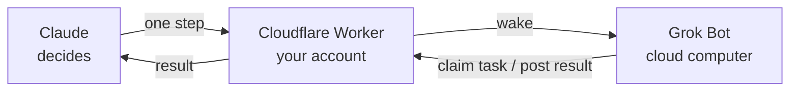

# Claude2GrokBot

[中文](README.md) | English

**Let Claude direct Grok Bot's cloud computer.**

> Want Grok Bot's cloud computer, but can't stand how dumb the Grok model is?

With Claude2GrokBot, the best model in the world directs Grok Bot as it operates the cloud computer. You keep the native experience and features of both Claude and Grok Bot. The difference: with this skill, the one sitting at the computer and working the mouse and keyboard for you is Claude.

- **Claude is the brain**: all thinking and deciding is done by Claude. It sends one step, checks whether Grok Bot's result is good enough, then decides the next
- **Grok Bot only executes**: it reads the screen, moves the mouse and types on the cloud computer, and returns the raw information it gets (text, screenshots, files) back to Claude in full
- **Unlimited rounds**: Claude and Grok Bot can go back and forth, confirm and collaborate for as many rounds as the task needs
- **Automatic wake-up**: Grok Bot is started even if it isn't running

**Built for work that needs a real computer**: sites that require a login, multi-step web flows, desktop apps, files on the cloud computer.

## Usage

**You need**: Grok Bot (with its desktop app), a Cloudflare account (free; you can sign up during setup), and the Claude desktop app or Claude Code (macOS / Linux / WSL; Node.js is installed automatically).

Copy this line and send it to your Claude (Claude desktop app / Claude Code):

```text
Run this, then set up Claude2GrokBot: curl -fsSL https://raw.githubusercontent.com/Parsiffall1/Claude2GrokBot/main/install.sh | bash
```

Claude installs it and does the whole setup. Follow its prompts for three steps:

1. Click **Allow** on the Cloudflare page that opens (sign up for free first if you have no account)
2. On the claude.ai consent page (sign in if asked), paste the password Claude gives you and click **Allow**
3. Send Claude's message to Grok Bot, then send Claude the webhook URL and key from Grok Bot's desktop app → **Routines → Claude2GrokBot wake**

Claude Code in a terminal has no browser, so for step 2 Claude gives you three lines to follow by hand.

Or download [claude2grokbot-skill.zip](https://github.com/Parsiffall1/Claude2GrokBot/releases/latest/download/claude2grokbot-skill.zip) and send it to Claude.

Then tell Claude in claude.ai (desktop or phone) "have Grok Bot, on its cloud computer, …", or call the Claude2GrokBot skill within any task. Each round uses one Grok Bot routine run.

## Not just Claude and Grok Bot

Both ends can be swapped, for example GPT directing Muse:

- **Decision side**: other top-tier models, such as GPT, as long as they support remote MCP connectors
- **Execution side**: other personal agents with a cloud computer, such as Muse, as long as a webhook can start them and they can make outbound HTTPS requests

## How it works



1. Claude sends one step; the service on your Cloudflare account wakes Grok Bot
2. Grok Bot does it on its cloud computer and reports what it saw
3. Claude decides the next step from that report, and the loop repeats

The service runs on your own Cloudflare account, within the free tier. Grok Bot only needs outbound HTTPS.

## Docs

[Technical reference](docs/reference.md) · [Security](docs/security.md) · [Architecture](docs/architecture.md) · [Setup guide (Chinese)](docs/SETUP.zh-CN.md)

MIT License
