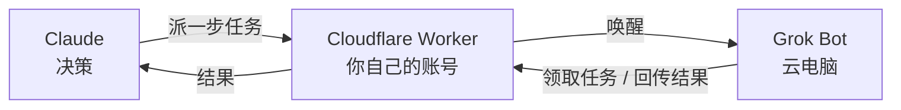

# Claude2GrokBot

中文 | [English](README.en.md)

**让 Claude 指挥 Grok Bot 的云电脑。**

> 想用 Grok Bot 的云电脑，但受不了 Grok 模型太蠢？

通过 Claude2GrokBot，你可以让全世界最优秀的模型来指挥 Grok Bot 操控云电脑。你依旧拥有 Claude 和 Grok Bot 的原生使用体验和功能，只不过用了这个 skill 之后，坐在电脑前操控鼠标和键盘帮你完成任务的，变成了 Claude。

- **Claude 是大脑**：所有思考和决策都由 Claude 完成。派一步，看 Grok Bot 返回的结果是否满意，再决定下一步
- **Grok Bot 只负责执行**：在云电脑上看屏幕、移动鼠标、敲键盘，并把执行中拿到的原始信息（文字、截图、文件）完整交回 Claude
- **多轮协作不设上限**：Claude 和 Grok Bot 可以按任务需要进行任意多轮的对话、确认和协作
- **自动唤醒**：即使 Grok Bot 没在运行，也会被自动唤醒

**适合需要真实电脑的工作**：强制登录的网站、多步骤的网页操作、桌面软件、云电脑上的文件。

## 使用方式

**前提**：Grok Bot（含桌面端）、Cloudflare 账号（免费，可在配置时注册）、Claude 桌面端或 Claude Code（macOS / Linux / WSL；Node.js 会自动装好）。

直接复制下面这句话发给你的 Claude（Claude 桌面端 / Claude Code）：

```text
运行 curl -fsSL https://raw.githubusercontent.com/Parsiffall1/Claude2GrokBot/main/install.sh | bash ，然后配置 Claude2GrokBot
```

Claude 会自动安装并完成全部配置，你只需要按 Claude 的指引完成三件事：

1. 在弹出的 Cloudflare 页面点 **Allow**（没有账号先免费注册）
2. 在 claude.ai 授权页（需要的话先登录）粘贴 Claude 给的口令，点 **Allow**
3. 把 Claude 给的消息发给 Grok Bot，再从 Grok Bot 桌面端 **例程 → Claude2GrokBot wake** 把 webhook 网址和 key 发回给 Claude

命令行版 Claude Code 没有浏览器，第 2 步会由 Claude 给你 3 行手动操作说明。

或下载 [claude2grokbot-skill.zip](https://github.com/Parsiffall1/Claude2GrokBot/releases/latest/download/claude2grokbot-skill.zip) 发给 Claude。

之后在 claude.ai（电脑或手机）里说「让 Grok Bot 在云电脑上……」即可，或在某一项任务中调用 Claude2GrokBot skill。每一轮会用掉一次 Grok Bot 例程运行。

## 不只是 Claude 和 Grok Bot

两端都可以换，例如让 GPT 指挥 Muse：

- **决策方**：其他顶级模型，例如 GPT，只要支持 MCP 远程连接器
- **执行方**：其他带云电脑的 personal agent，例如 Muse，只要能被 webhook 唤醒、能发出站 HTTPS 请求

## 原理



1. Claude 派一步任务，你 Cloudflare 账号上的服务唤醒 Grok Bot
2. Grok Bot 在云电脑上操作，回传看到的结果
3. Claude 根据结果决定下一步，回到第 1 步

服务跑在你自己的 Cloudflare 账号上，在免费额度内。Grok Bot 只需要出站 HTTPS。

## 文档

[配置指南](docs/SETUP.zh-CN.md) · [技术参考](docs/reference.md) · [安全](docs/security.md) · [架构](docs/architecture.md)

MIT License
